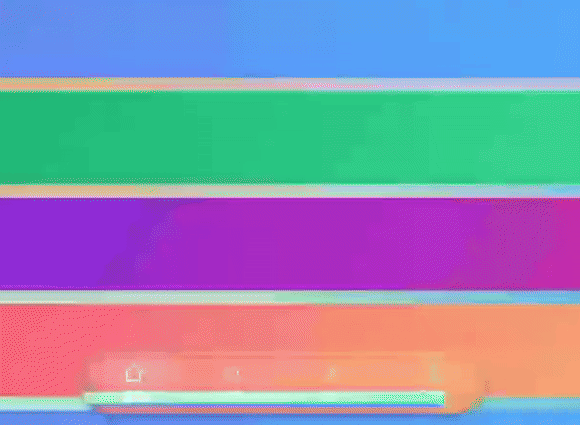

# Liquid Glass Bottom Bar — 底栏液态玻璃跨软件可复用方案



> 上图:Web 演示实时录制 —— 底栏对滚动内容的**真折射**(SVG 位移贴图,非毛玻璃贴图),tab 弹簧切换。
> 从三个真实来源提炼、可直接落地的「底栏液态玻璃」处理方案:
> **① NPatch 管理器**(生产级 Android Compose 实现,APK 逆向 + 源码核对)·
> **② [xiaofangstudio/liquid-glass-web](https://github.com/xiaofangstudio/liquid-glass-web)**(Web 端 SVG 位移贴图折射)·
> **③ [Kyant0/AndroidLiquidGlass](https://github.com/Kyant0/AndroidLiquidGlass)** 路线的教学 Demo(配套可运行工程)。

iOS 26 的 Liquid Glass 底栏 = 一块**实时采样背后内容的玻璃胶囊**:
`背景采样 → 提饱和 → 磨砂 → 边缘折射 → 色散 → 表面高光/内阴影 → 交互动效`。
本仓库给出这条管线在 **Android Compose** 与 **Web** 上的两套完整实现、一份跨平台**参数速查表**、以及**分级降级策略**。

## 目录结构

```
├── README.md                        ← 你在这里:结论总览
├── docs/
│   ├── 01-通用架构.md               ★ 五层分层模型 + 底栏特有处理(必读)
│   ├── 02-Android-Compose.md        NPatch 生产级 & Kyant0 教学级两条路线
│   ├── 03-Web.md                    liquid-glass-web 技术移植到底栏
│   ├── 04-参数速查表.md             ★ 三平台参数对照(核心资产)
│   ├── 05-降级与兼容.md             API 分级 / 浏览器兼容 / 无障碍兜底
│   ├── 06-厂商实践篇.md             ★ 酷安 v16 逆向 + Kuikly(QQ)/ROM 厂商做法
│   ├── 07-谱系考.md                 GitHub 液态玻璃项目谱系实测(Kyant0 是枢纽不是源头)
│   └── img/                         演示 GIF 与截图
├── android/
│   ├── sample-app/                  ✅ 可一键运行的完整 Gradle 工程(Android Studio 直接 Run)
│   ├── compose-backdrop/
│   │   └── GlassBottomBar.kt        教学级:Kyant0 backdrop 库 30 行配方
│   └── compose-miuix/               生产级:NPatch 底栏完整源码(GPL-3.0,见目录内 README/LICENSE)
│       ├── FloatingGlassBottomBar.kt   ← 三层玻璃结构 + 阻尼拖拽指示器
│       ├── liquid/                     Lens / InnerShadow / Vibrancy / CombinedBackdrop
│       └── miuix/                      animation(DampedDragAnimation/InteractiveHighlight)+ modifier
├── web/
│   └── bottombar-liquid-glass.html  ✅ 自包含演示:双击浏览器直接打开(Chromium)
└── reference/
    ├── npatch-apk-逆向分析.md       APK 逆向证据链与分析方法论
    ├── 调研报告-LiquidGlass-Android实现方案.md   Android 生态全库调研
    └── sources.md                   全部来源链接
```

## 一分钟结论

**1. 所有平台共用同一条五层管线**(详见 [docs/01-通用架构.md](docs/01-通用架构.md)):

| 层 | 作用 | Android(Compose) | Web |
|---|---|---|---|
| 1 背景采样 | 离屏复制玻璃背后的内容 | `rememberLayerBackdrop` + `Modifier.layerBackdrop` | 无需(浏览器自动) |
| 2 提饱和 vibrancy | 内容透过玻璃更"鲜艳" | `colorControls(saturation=1.5)` | `saturate(1.1)` |
| 3 磨砂 blur | 半透明磨砂面 | `blur(4.dp)` | `blur(0.25px) + contrast/brightness` |
| 4 边缘折射 lens | 圆角矩形 SDF 高度场位移采样,色散 | AGSL `RuntimeShader`(见 `liquid/Lens.kt`) | `feImage` 位移贴图 + `feDisplacementMap` |
| 5 表面处理 | 白面 tint、顶部高光、内阴影 | `onDrawSurface` + `innerShadow` | `rgba(255,255,255,.08)` + inset box-shadow |

**2. 底栏 ≠ 普通玻璃按钮**,有 4 条专门规则:

- **悬浮胶囊**:底部留 `12dp + 导航栏 inset`,不贴边,全圆角(pill);
- **内容必须延伸到玻璃之下** —— 不能把 Scaffold 的 bottom padding 加在内容上,否则背景采样被裁剪、玻璃采到空白(NPatch 源码注释原话:"Applying Scaffold's bottom padding here clips the recorded backdrop above the navigation bar");
- **backdrop 先填底色**:`rememberLayerBackdrop { drawRect(surface); drawContent() }`,防止玻璃采样到透明像素;
- **指示器三层结构**(iOS 26 聚焦效果的关键):玻璃面板 → *不可见* 的 tab 内容副本(登记进第二个 backdrop)→ 移动的指示胶囊,其折射源 = `全局背景 + tab 内容` 的 CombinedBackdrop。

**3. 交互与光效的可复用参数**(详见 [docs/04-参数速查表.md](docs/04-参数速查表.md)):

- 面板玻璃:`blur 4dp` + `lens(24dp, 24dp)`;指示器按压时 `lens(10dp·p, 14dp·p)` + 色散 `0.5`(p = 按压进度);
- ⚠️ 观感取舍:`lens(refractionHeight)` 是"边缘弯曲带"厚度 —— 24dp 在 64dp 高的面板上意味着中心平坦区只剩 16dp,背景扭曲感强;**带文字的底栏建议 12~16dp 起步**(Kyant0 demo 的 16dp 更接近 iOS 26 观感);
- 按压联动:tab 缩放 `1→1.2`、内阴影 `0→8dp`、面板微膨胀 `+16dp/width`;
- 拖拽跟手:阻尼动画 + 橡皮筋 `4dp·EaseOut` + 速度挤压 `scaleX/=1-0.75v`、`scaleY*=1-0.25v`;
- 动态光:加速度计旋转镜面高光位置(双光源 BloomStroke)。

**4. 降级三板斧**(详见 [docs/05-降级与兼容.md](docs/05-降级与兼容.md)):
API 33+ 全效果 → API 31+ 磨砂(blur 25dp + 65% tint)→ 更低/无 backdrop 时普通底栏;Web 端仅 Chromium 支持 `backdrop-filter: url(#svg)`,Firefox 自动降级毛玻璃。

## 快速开始

**① Web(30 秒看到效果)** —— 用 Chromium/Edge 打开 [`web/bottombar-liquid-glass.html`](web/bottombar-liquid-glass.html)
(或直接双击本地文件),滚动页面、点 tab:底栏对背后内容实时折射 + 指示器弹簧切换。
非 Chromium 自动降级毛玻璃;`prefers-reduced-motion` 下动画自动关闭。

**② Android(一键运行)** —— 用 **Android Studio**(Ladybug+)打开 [`android/sample-app/`](android/sample-app),
等 Gradle Sync 完成后点 Run(API 33+ 真机/模拟器有完整折射;31/32 自动降级磨砂)。
依赖只有一个 Maven 包:`io.github.kyant0:backdrop:2.0.1`。

**③ Android(30 行接入自己的工程)** —— 复制 [`android/compose-backdrop/GlassBottomBar.kt`](android/compose-backdrop/GlassBottomBar.kt):

```kotlin
val backdrop = rememberLayerBackdrop { drawRect(surfaceColor); drawContent() }
Content(Modifier.layerBackdrop(backdrop))          // 页面内容登记进采样
GlassBottomBar(backdrop)                            // 底栏;列表尾部自己发 contentPadding
```

**④ Android(生产级参考)** —— [`android/compose-miuix/`](android/compose-miuix)(NPatch 同款,GPL-3.0):
含拖拽跟手指示器(`DampedDragAnimation`)、交互高光、内阴影下陷、光谱色散等完整源码。
注意:其依赖的 miuix blur 模块未发布 Maven,移植方式见该目录 README;**不要拿它当起点**,先跑 ②。

## 来源与许可

- `android/compose-miuix/` 来自 [7723mod/NPatch](https://github.com/7723mod/NPatch)(GPL-3.0,目录内附 LICENSE),文件头保留原始许可与移植说明;
- `android/compose-backdrop/` 与 `android/sample-app/` 基于 [Kyant0/AndroidLiquidGlass](https://github.com/Kyant0/AndroidLiquidGlass) API(Apache-2.0)编写;
- Web 演示的折射引擎技术来自 [shuding/liquid-glass](https://github.com/shuding/liquid-glass)(MIT)与 [xiaofangstudio/liquid-glass-web](https://github.com/xiaofangstudio/liquid-glass-web)(MIT);
- 本仓库原创文档与演示:MIT,**仅适用于未被单独标注许可的文件**(scope 见 [LICENSE](LICENSE) 顶部与 [NOTICE.md](NOTICE.md))。
